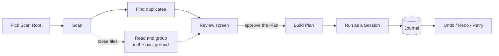
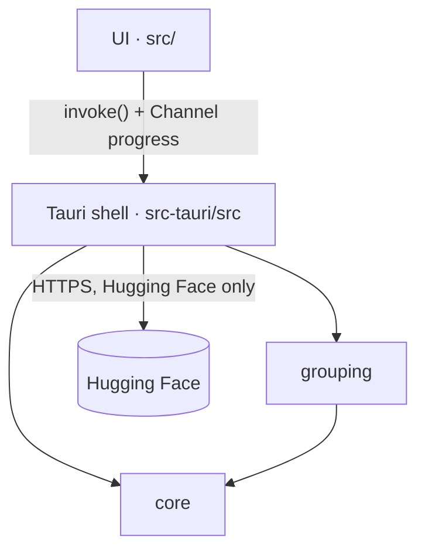
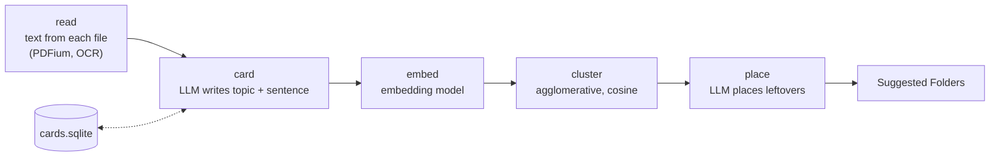

# Architecture

This document describes the high-level architecture of files-cleaner. If you want to get familiar with the code, you're in the right place. For the words used here (Scan Root, Plan, Session, …) see [`GLOSSARY.md`](GLOSSARY.md); for why things are the way they are, see [`docs/adr/`](docs/adr/).

## Bird's Eye View

The app takes one folder (the Scan Root) and, after the user approves it, changes it in three ways: trashes duplicate copies, moves loose files into Suggested Folders, and trashes folders that end up empty. Every change is written to the Journal before it happens, so it can be undone, even after a crash.



The input is a folder on disk; the output is a set of moves and trashes, all recorded. Nothing is deleted for good: a Trash goes to the System Trash, which the user empties themselves.

## Layers

```
files-cleaner/
├── src/                     UI: plain HTML/CSS/JS modules, no framework, no build step
└── src-tauri/
    ├── src/                 Tauri shell: thin commands, model downloads
    ├── core/                Scanning, planning, running, Journal, Undo (no Tauri)
    └── grouping/            Suggested Folders: reading files, Grouping Models, clustering
```



Dependencies only point down. `core` knows nothing of Tauri or `grouping`; `grouping` knows `core`'s types but not Tauri.

## Code Map

### `files-cleaner/src` (UI)

`main.js` shows one screen at a time; each screen under `screens/` exports `render(root, nav, ...args)` and builds its own DOM. `shared/api.js` is the only place that calls Tauri: one function per command. Its `stepFlow` holds the scan → duplicates → review order, given its commands so it can be tested. `shared/menus.js` keeps the native menus in step with the screen shown: it works out what applies and each shortcut as the OS writes it, sends that to the backend and runs what's clicked. No JS file under 100 lines: small pieces live in the file that uses them. `tests/setup.js` stands in for the webview so any of these files can be imported in a test.

**Architecture Invariant:** the UI holds no file-system logic. It only shows what the core returns and sends back the user's choices.

### `src-tauri/src` (shell)

- `lib.rs`: every Tauri command. Each finds the app's paths (config, Sessions folder, models folder), calls `core` or `grouping`, and serialises the result. It also keeps the latest scan, Duplicate Groups and Plan in memory, so the UI never sends them back.
- `menu.rs`: the native menu bar, the same on every OS, and the native right-click menus. The UI says which items apply and describes each right-click menu; clicks come back to it as events.
- `models.rs`: downloading, pausing and removing the Grouping Models, each pinned by SHA-256.
- `downloads.rs`: the app's **only** network code.

**Architecture Invariant:** commands are thin. Logic that matters goes in `core`, where it can be tested without a UI (ADR 0003).

**Architecture Invariant:** only `downloads.rs` touches the network, and only Hugging Face over HTTPS. `tests/network.rs` fails if any other file uses an HTTP client or a socket.

### `src-tauri/core`

The safety-critical part. Its public functions (re-exported from `lib.rs`) are the test seam.

| Module | Does |
| --- | --- |
| `scanner` | Walks the Scan Root, skipping Protected Paths, hidden files and symlinks |
| `protection/` | "May the app touch this path?" One file per OS |
| `duplicates` | Duplicate Groups: size, then partial hash, then full BLAKE3 |
| `suggested_folders`, `planner` | Turn the user's choices on the Review screen into a Plan of Operations |
| `executor` | Runs a Plan as a Session; Undo, Redo, Retry |
| `journal`, `database` | The Journal in SQLite, and the lock that lets one Session run at a time |
| `session_journal` | Reads a Session's Journal back into the state of each Operation. Used by `executor` and `sessions` |
| `sessions` | Past Sessions for the History screens |
| `os_trash/` | Sends items to the System Trash and back. One file per OS |
| `config`, `recent`, `atomic_file` | Small JSON settings files, replaced atomically |

**Architecture Invariant:** every Operation is journaled (and committed) *before* it touches the disk. That is what makes Undo work after a crash (ADR 0012).

**Architecture Invariant:** the core never deletes permanently and never edits file contents. It only moves, creates folders, and sends to the System Trash, which it never empties.

**Architecture Invariant:** nothing acts on files except an approved Plan. Rules only shape the Plan, never act on their own (ADR 0013), and there's no learning from past Plans (ADR 0011).

### `src-tauri/grouping`

Turns the Scan Root's Loose Files into Suggested Folders. `analyse` is the entry point.



- `read`: a short text per file, from its name and, where the format allows, what's inside it.
- `llama`: both Grouping Models on llama.cpp (Metal on macOS, Vulkan elsewhere, CPU fallback). Behind the `Models` trait, so tests use fakes.
- `store`: a cache of cards and embeddings, keyed by content hash and model IDs, so a file is read only once.
- `kinds`: files that are never read (archives, images, installers) are grouped by kind instead.

**Architecture Invariant:** all heavy native code (llama.cpp, PDFium, Tesseract) lives here, not in `core`. Files are only ever opened for reading.

**Architecture Invariant:** without the Grouping Models, the app still works: Suggested Folders come from file kind, name and date only.

## Cross-Cutting Concerns

**Progress.** Long commands (scan, duplicates, analysis, run, Undo, Redo, Retry) take a Tauri `Channel` and report progress on it; the UI turns that into a status line, and works out the time left itself.

**Storage.** All app data sits in the OS's app data folder: `journal.sqlite` (Sessions), `cards.sqlite` (the grouping cache), the Grouping Models, and a few small JSON files (config, Recent Scan Roots, onboarding). Settings are changed only from the Settings screen.

**Platforms.** OS differences are confined to `core/src/protection/` and `core/src/os_trash/`, one file per OS. Everything else is shared.

**Testing.** Rust tests live in `core/tests/` and `grouping/tests/` and drive the public functions on temporary folders. UI tests (`files-cleaner/tests/`) cover the pure JS modules, not the DOM.
